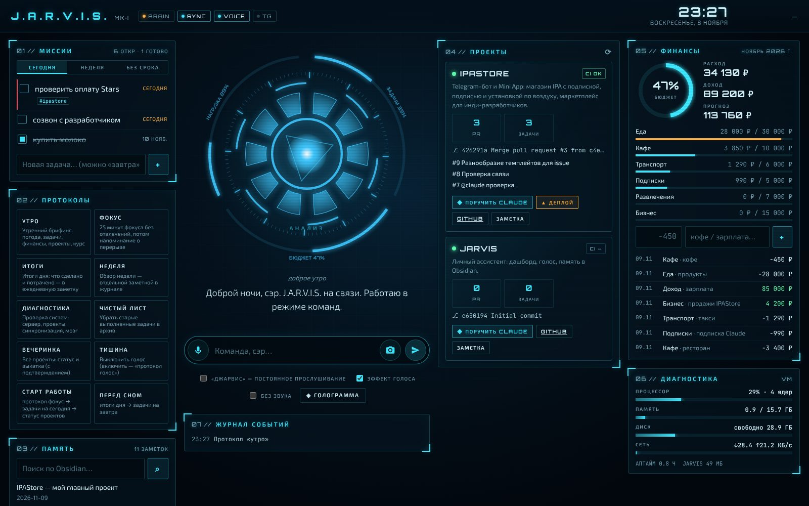

# A.T.O.M. — личный ассистент и дашборд

Свой Atom: голосовой ассистент с HUD-интерфейсом в духе фильма, который ведёт проекты, задачи,
финансы и дела, а **всю память хранит в Obsidian**.

**Только iPhone, без компьютера и сервера** → [docs/iphone.md](docs/iphone.md): приложение с экрана
«Домой» (GitHub Pages), память — приватный репозиторий с хранилищем Obsidian (на телефоне его
синхронизирует плагин Obsidian Git), мозг — Claude прямо с телефона, оповещения в Telegram — через
GitHub Actions. Есть и серверная версия (Python) — с нейроголосом, Syncthing/LiveSync и Claude Code.



> **Ребрендинг Jarvis → Atom.** Название, голос («Атом, …»), промпт и красная палитра HUD — новые. Ради
> совместимости с уже работающими установками прежними остались внутренние имена: пакет `jarvis`
> (`python -m jarvis`), переменные `JARVIS_*`, служба `jarvis` на VPS и папка памяти `Jarvis/` в хранилище
> (её можно переименовать через `VAULT_JARVIS_DIR`). Своё слово-активатор задаёт `WAKE_WORD`.

## Возможности

- **Память в Obsidian.** Задачи, финансы, проекты, факты о вас, журнал и разговоры — обычные
  markdown-заметки. Правите заметку на телефоне — дашборд обновляется за 1–2 секунды.
- **Бесплатная синхронизация в реальном времени** — Self-hosted LiveSync (iPhone, ПК, Android) или
  Syncthing; всё поднимается одной командой `docker compose`. → [docs/sync.md](docs/sync.md)
- **Голос.** «Атом, …» — распознавание речи в браузере, ответы нейроголосом с «металлическим»
  эффектом и эхом, как у ИИ из фильма.
- **Мозг — Claude.** С ключом API понимает свободную речь, сам решает, что записать в память,
  ищет в интернете, разбирает фото чеков. Без ключа — быстрые команды на русском.
- **Работа над проектами** (например, IPAStore): статус CI, PR и задач GitHub, проверка
  «жив ли сервис», метрики магазина; «поручи IPAStore: …» → задача для @claude, который откроет PR,
  или Claude Code прямо на вашем компьютере; деплой — по подтверждению.
- **Хранилище — менеджер заметок и проектов** (кнопка ▤ вверху, вкладка «ФАЙЛЫ» на телефоне, «открой хранилище»):
  дерево папок, теги, недавние, поиск по названию и тексту (`#тег` — по тегу); заметка открывается рядом —
  с тегами и списком «ссылаются сюда». Новые заметки — пустые или по шаблонам из `Templates/` (встреча, идея,
  конспект; `{{title}}`, `{{date}}`, `{{time}}` — как в Obsidian), новые папки. Переименование и перенос
  (кнопками или перетаскиванием на папку) — и Atom сам правит `[[ссылки]]` на заметку во всём хранилище.
  Удалённое уходит в корзину Obsidian (`.trash/`), а не стирается.
  **Страница проекта**: статус (идея · в работе · на паузе · завершён), прогресс по задачам, задачи проекта
  (добавить и отметить прямо там — пишутся в заметку проекта), заметки проекта (папка `Projects/<Проект>/` и
  всё, что ссылается на проект), журнал, поручение Claude. Новый проект — «＋ ПРОЕКТ» или «создай проект Кофейня».
- **Умный синтез проектов** (вкладка «СИНТЕЗ» в хранилище, «синтез проектов», «какие проекты есть в хранилище»):
  Atom сам разбирает хранилище и **подсвечивает** в дереве, списках и графе голограммы
  ◆ заметки, которые относятся к проектам (папка проекта, его #тег, ссылка [[Проект]], задачи с тегом), и
  ✦ то, что похоже на ещё не оформленный проект: заметку с `type: project` вне `Projects/`, #тег в нескольких
  заметках и задачах, папку с заметками, «узел», на который ссылаются несколько заметок. У каждого кандидата —
  причины и его заметки; «◆ ОФОРМИТЬ ПРОЕКТОМ» создаёт `Projects/<Название>.md` с тегом и ссылками на материалы
  (сами заметки остаются на месте). Без модели и интернета — одинаково на сервере и на iPhone; с Claude —
  инструмент `projects_synthesis` («собери из моих заметок про ремонт проект»).
- **Финансы**: траты голосом, бюджеты по категориям, прогноз на месяц, предупреждения о перерасходе.
  Приложение «Финансы» (в каталоге приложений): доходы и расходы за полгода, категории к среднему, **регулярные платежи**
  (найдутся сами — и видно, какие в этом месяце ещё не оплачены, внести — одной кнопкой), частые операции
  «в одно касание», выводы. **Активы** (`Finance/Assets.md`): акции, фонды и облигации по Мосбирже, крипта по
  CoinGecko, валюта по ЦБ, имущество — по виду (техника дешевеет, недвижимость дорожает) или по своей оценке;
  **долги** — таблица и проекты с тегом `долг`; чистый капитал и его история по дням (`Finance/Capital.md`).
  Голосом: «проанализируй мои расходы», «какой у меня капитал».
- **Хранилище** (▤): обзор — сколько заметок, что менялось недавно, на какие заметки чаще ссылаются, заметки без
  связей и «несозданные» заметки из [[ссылок]] (создать — одной кнопкой); избранное ★, сортировка, список или
  карточки, выбор нескольких заметок (переместить, в корзину, в избранное), «Сегодня» — заметка дня.
- **Карта и навигация** (в каталоге приложений): открывается там, где вы (геолокация; без неё — где закрыли карту в
  прошлый раз), поиск мест с подсказками рядом с вами, маршруты на машине, пешком и на велосипеде с вариантами и
  списком поворотов, пошаговая навигация по GPS с голосом и перестроением, «Рядом» (кафе, аптеки, метро, банкоматы,
  АЗС…), «Что здесь?» и меню по долгому нажатию, мои места (`Jarvis/Places.md`, «Домой» / «На работу»), слои
  «Карта / Тёмная / Спутник», 3D-здания, линейка, «поделиться». Бесплатные сервисы OpenStreetMap, без ключей.
  Голосом: «маршрут до вокзала», «как дойти до парка», «аптеки рядом», «где я», «покажи на карте Арбат».
- **Команда** (👥): операторы — люди, которые помогают вести дела. Пригласите по одноразовой ссылке (или человек
  при первом запуске выберет «Я оператор» и вставит её), задайте права, поручайте задачи и встречи, переписывайтесь
  в чате (`Jarvis/Chat/<Имя>.md`), отключайте и удаляйте. Оператор видит только свой кабинет: порученные задачи и
  встречи (отмечает выполненное), свой список задач и личные заметки (папка `Команда/<Имя>/`), только общие с ним
  проекты, **приложения**, к которым вы дали доступ («открывать» или «управлять» — править заметку приложения и
  вести задачи его проекта), **доверенные заметки** (заметка или папка, только чтение или с правкой) и чат с вами.
  Право «ставить задачи в общие проекты» — по галочке. Приняв приглашение, оператор задаёт пароль и дальше входит по имени и паролю с любого
  устройства; в «Устройствах» видно, где он вошёл, — выйти можно на любом (и владельцу — в «Команде» → «Мои устройства»). При первом запуске Atom спрашивает
  «Кто вы?»: владелец задаёт пароль (или работает без него — тогда приглашать нельзя).
- **Встречи**: задачи с тегом `#встреча`, временем и местом — панель на главной, отметить «состоялась» одним нажатием,
  голосом «какие встречи», «встречи на завтра».
- **Приложения** (⊞ в шапке, «Приложения» в нижней навигации): встроенные — Карта, Финансы, Хранилище, Граф памяти,
  Команда, Настройки и диагностика — и свои программы: проекты с `catalog: true` («＋ Добавить») и заметки с
  `type: app`. Поля: `url` — где открыть (https-приложение открывается прямо внутри Atom, «↗» — в новой вкладке),
  `icon` — эмодзи, `repo`. Например, **Ценники** (`c4erepk0/cenniki`, GitHub Pages). Внутри Atom «Ценники» сохраняют
  файлы через окно Atom «Файл готов» (поделиться, печать, скачать — работает и на iPhone), а изделия и прайсы у них
  **общие**: что сделал владелец, сразу видят операторы с доступом к приложению, и наоборот (данные — на сервере
  Atom, пять прошлых версий хранятся на случай ошибки).
- **Глобус** (в каталоге приложений): анализатор новостей и тактический инвестор в прямом эфире. Земля из частиц,
  на ней появляются маркеры новостей по мере прихода — конфликты, катастрофы и землетрясения (USGS), экономика,
  политика, технологии; **экономический маркер** (◆) — новость с явным прогнозом («ОПЕК+ планирует сократить
  добычу», «ЦБ может повысить ставку»), который влияет на рынок: от него тянутся дуги к рынкам (нефть, газ, золото,
  рубль, акции РФ и США, ставки, крипта, зерно, чипы, Китай). Справа — лента с фильтрами, карточка новости с
  влиянием на рынки, **тактика** (давление на рынки за 48 часов, ваши позиции из «Финансы → Активы» — попутный или
  встречный ветер, идеи) и котировки-ориентиры. «🧠 Разбор» и «Сводка» — глубокий анализ мозгом Atom с поиском в
  интернете. Сигналы пишутся в `Jarvis/News/Сигналы.md`, о сильных прогнозах по вашим активам Atom предупредит (и в
  Telegram). Голосом: «что на рынках», «главные новости», «открой глобус». Источники — BBC, Al Jazeera, РИА, ТАСС,
  Интерфакс (свои — `NEWS_FEEDS`), без ключей. Это сигналы по заголовкам, не инвестиционная рекомендация.
- **Настройки и диагностика** (⚙): показатели сервера (процессор, память, диск, сеть — и подсказка, когда серверу
  тесно), состояние служб, **ключи и токены** (Claude, Telegram, GitHub, GigaChat/Yandex… и свои — под любым именем,
  они попадают в окружение), **SSH-серверы** (адрес, пользователь, пароль или ключ, «Проверить»), **обновления с
  GitHub** — проверить, обновить с подтверждения или автоматически раз в N часов, перезапуск. Всё хранится в
  `data/settings.json` (права 600), не в хранилище; секреты наружу не отдаются — видно только «задан: sk-…a1b2».
- **Дашборд**: сфера из частиц (three.js), которая дышит, волнуется от голоса и закручивается, когда Atom думает;
  числа докручиваются, панели появляются плавно, в «Финансах → Категории» — 3D-карта расходов; на главной — задачи, ядро с
  командной строкой, проекты и журнал (финансы, карта, файлы и показатели сервера — в каталоге приложений); 3D-граф памяти с управлением жестами рук: точки можно перетаскивать (место
  запоминается, «⟲» — сброс), размер точки — по числу связей. Нажмите на узел (или скажите
  «открой заметку IPAStore») — заметка откроется прямо в голограмме: с разметкой Obsidian, переходами по
  [[ссылкам]] и галочками задач; там же её можно поправить или создать новую. Если заметку тем временем
  изменили в Obsidian, Atom не затрёт правку, а предложит выбрать версию. При первом включении
  жестов Atom проводит калибровку: шаг за шагом показывает жест и засчитывает его, только когда камера
  его действительно увидела (повторить — кнопка «?» в голограмме).
- **Жесты** (камера телефона или ноутбука, кадры никуда не уходят) — заметку можно открыть, поправить
  и закрыть, не касаясь экрана:

  | Жест | Что делает |
  |---|---|
  | ☝ палец, задержка 1 с | на узле — открыть заметку; на кнопке, галочке задачи или [[ссылке]] — нажать |
  | 🤏 щипок и движение | вращать граф; над текстом заметки — листать его |
  | 🤏🤏 щипок двумя руками | масштаб |
  | ✋ ладонь 1 с | сброс вида |
  | 👋 взмах ладонью | вправо — предыдущая заметка, влево — следующая (без заметки — повернуть граф) |
  | ✌ два пальца | открыть заметку для правки; в правке — продиктовать строку («задача купить молоко» → `- [ ] Купить молоко`) |
  | 👍 большой палец вверх | сохранить правку / создать заметку |
  | ✊ кулак | закрыть заметку или правку; при несохранённых правках — сначала предупреждение, второй ✊ выбрасывает их |

  Пока жест держится, над графом видно, что он сделает, и полоска удержания; если сейчас жест ни к чему
  (например, ✊ без открытой заметки), там же подсказка, что сделать. На окошке камеры подписано, что Atom
  видит («вижу: ✌ два пальца» или «не вижу руку» — тогда подойдите ближе или к свету). Кто уже проходил
  калибровку, при включении жестов увидит короткое обучение только новым жестам.
- **Взгляд вместо курсора** (кнопка 👁 в голограмме): курсор следует за взглядом, а ближайшая к нему кнопка,
  галочка задачи, [[ссылка]] или заметка на графе подсвечивается; **короткий щипок** (свести и развести пальцы) —
  нажать подсвеченное; щипок и движение — вращать граф или листать заметку, на которую смотрите; ✊ ✌ 👍 ✋ 👋 — как
  выше. Сам взгляд ничего не нажимает — только жест. Сила «магнита» — выкл / слабый / средний / сильный (кнопка ◎).
  Калибровка: **быстрая** ~25 с, **большая** ~1 мин — точка плавно переезжает и пишет, только когда взгляд устоялся.
  При каждом включении взгляда — **привязка** по 3 точкам (~6 с): убирает сдвиг новой сессии (свет, поза). После
  каждого нажатия щипком курсор **сам поправляется** туда, где был взгляд. Взгляд считается только по глазам
  (зрачки, eyeLook, открытость глаз, поворот лица): на калибровках владельца это в среднем ~64 px в работе против
  ~133 px у прежней модели с положением головы, которое «путало» модель между сессиями. Телефон держат совсем иначе —
  на окошке камеры «поза другая — ◎ привязка». Повернули экран — откалибруйте заново.
- **Записи взгляда для анализа**: каждая калибровка и журнал нажатий сохраняются в хранилище — `Jarvis/Gaze/sessions`
  и `Jarvis/Gaze/usage` (точки глаз и лица по кадрам, без фото; на голограмме их нет). `node scripts/gaze_eval.mjs
  --import <хранилище>/Jarvis/Gaze` переносит их в тесты, а `node scripts/gaze_eval.mjs` показывает точность,
  что даёт каждая группа признаков и доучивание; тест `tests/js/gaze-sessions.test.mjs` не даёт ухудшить точность
  на ваших калибровках.

## Механики из «Железного человека», которые уже можно сделать

| В фильме | В Atom |
|---|---|
| «Атом, …» — разговор голосом | Слово-активатор и постоянное прослушивание (Web Speech API), ответ голосом |
| Утренний доклад | Протокол «Утро»: погода, задачи, бюджет, сборки проектов, курс ЦБ; в 08:30 — в Telegram |
| Голограммы, которые крутят руками | 3D-граф заметок Obsidian; щипок — вращение, две руки — масштаб, палец — выбор, ладонь — сброс (MediaPipe) |
| Диагностика костюма | Диагностика сервера: процессор, память, диск, сеть, батарея; тревога при перегрузке |
| «Сэр, у нас проблема» | Проактивные оповещения: упала сборка CI, сервис не отвечает, бюджет превышен, напоминания |
| Протоколы («Домашняя вечеринка», «Чистый лист») | Протоколы: Утро, Фокус, Итоги дня, Неделя, Диагностика, Чистый лист, Вечеринка (статус и выкатка всех проектов), Тишина + свои в `Jarvis/Protocols.md` |
| Atom работает в мастерской вместе с Тони | «Поручи IPAStore: …» — Claude пишет код (GitHub или локально), ход работы — в панели «Мастерская» |
| Анализ того, что видит камера | Фото чека или документа → Claude сам записывает расходы и задачи |
| Atom помнит всё | Долговременная память в Obsidian: факты, профиль, журнал, разговоры |

Голос: Jarvis говорит в манере британского дворецкого, нейроголосом (по умолчанию ru-RU-DmitryNeural,
чуть ниже и медленнее) с эффектом «ИИ» поверх. Голос конкретного актёра не клонируется — это
чужой голос, на который нужно разрешение. Можно подключить любую Piper-модель, на которую у вас
есть права (например, свой голос): `TTS_ENGINE=piper`, `PIPER_MODEL=…`.

## Два режима

| | Только iPhone | Сервер (Python) |
|---|---|---|
| Где работает | Safari на iPhone (иконка на экране «Домой») | компьютер или сервер, дашборд — в браузере |
| Память Obsidian | приватный GitHub-репозиторий + Obsidian Git (≈1 мин) | папка + LiveSync / Syncthing (секунды) |
| Голос | системный голос iPhone | нейроголос с эффектом ИИ |
| Оповещения при закрытом приложении | Telegram через GitHub Actions (раз в 15 мин) | Telegram сразу |
| Работа над кодом | задачи для @claude на GitHub | + Claude Code на этом компьютере |

Ядро одно по логике и формату заметок: Python (`jarvis/`) и JavaScript для iPhone
(`jarvis/webapp/static/core/`) пишут в Obsidian одинаково, поэтому режимы можно совмещать.

## Быстрый старт (сервер)

> **Свой VPS за 150–500 ₽ в месяц** — постоянная https-ссылка, работает круглосуточно, ставится одной
> командой с iPhone: [docs/hosting.md](docs/hosting.md).
>
> Запускаете в терминале на телефоне, на VPS или в облаке? Добавьте `--tunnel`:
> `bash start.sh --tunnel` — Atom поднимет бесплатный HTTPS-туннель, сам задаст код входа и напечатает
> ссылку для Safari. Адрес `localhost` терминала Safari на iPhone не видит.

```bash
git clone https://github.com/c4erepk0/Jarvis_claude && cd Jarvis_claude
bash start.sh          # macOS: двойной клик по start.command, Windows: start.bat
```
Откройте http://localhost:8765. Пустая папка `vault/` заполнится стартовой структурой — откройте её
в Obsidian как хранилище (или укажите своё в `VAULT_PATH`).

Дальше по желанию в `.env`:
- `GIGACHAT_AUTH_KEY` или `YANDEX_API_KEY` + `YANDEX_FOLDER_ID` — мозг на GigaChat или YandexGPT (доступны в России, [docs/brain.md](docs/brain.md); на сервере — `bash /opt/jarvis/scripts/vps.sh brain`);
- `ANTHROPIC_API_KEY` — свободная речь, поиск, фото (модель `claude-opus-5-5`, `JARVIS_EFFORT=low` для
  быстрых голосовых ответов);
- `GITHUB_TOKEN` — статус приватных репозиториев, задачи для @claude, деплой;
- `TELEGRAM_BOT_TOKEN` + `TELEGRAM_OWNER_ID` — оповещения и команды из Telegram;
- `VAULT_PATH` — ваше хранилище Obsidian;
- `VAULT_GIT=c4erepk0/jarvis-vault` — хранилище в приватном GitHub-репозитории: Jarvis скачает его сам и будет
  синхронизировать с Obsidian на iPhone (плагин Obsidian Git), заметки сливаются построчно.

### Docker (сервер)

```bash
cp .env.example .env            # задайте JARVIS_ACCESS_CODE
docker compose up -d                         # Atom
docker compose --profile livesync up -d      # + синхронизация с Obsidian на iPhone/ПК (см. docs/sync.md)
```

### С телефона

Микрофону и камере нужен HTTPS. Самый простой бесплатный путь — **Tailscale**:
`tailscale serve --bg --https=443 http://127.0.0.1:8765` → откройте `https://<сервер>.<tailnet>.ts.net`
в Safari → «Поделиться» → «На экран „Домой“». Дашборд станет приложением с иконкой реактора.

## Память в Obsidian

```
Home.md                    — главная
Jarvis/Profile.md          — «обо мне»: попадает в каждый разговор
Jarvis/Memory.md           — факты, которые Atom узнал сам («запомни, что…»)
Jarvis/Protocols.md        — ваши протоколы
Jarvis/Conversations/      — разговоры по дням
Tasks/Inbox.md             — входящие задачи
Projects/IPAStore.md       — проект: status, tag, repo, path, health, stats_url, deploy_workflow в начале файла
Projects/IPAStore/         — заметки проекта (встречи, брифы): видны на странице проекта
Templates/                 — шаблоны новых заметок ({{title}}, {{date}}, {{time}})
Finance/2026-11.md         — операции месяца (таблица), Finance/Budget.md — лимиты
Finance/Assets.md          — активы и долги (таблицы), Finance/Capital.md — капитал по дням
Journal/2026-11-09.md      — ежедневная заметка: журнал Atom, итоги дня
```
Задачи — в формате плагина **Tasks** (`- [ ] Текст ⏫ 📅 2026-11-10 #ipastore`), их можно писать
в любой заметке. Расход в таблице финансов — со знаком минус.

## Команды (работают и без Claude)

- «Доброе утро» · «протокол фокус» · «итоги дня» · «протокол Старт работы»
- «Добавь задачу написать оферту для IPAStore в пятницу, срочно» · «задачи на сегодня» · «выполнил оферту»
- «Потратил 450 на кофе» · «минус 1,5к такси» · «получил 50 000 зарплата» · «сколько я потратил»
- «Напомни через 20 минут позвонить» · «запомни, что я пью эспрессо» · «найди в заметках сертификат»
- «Статус проектов» · «поручи IPAStore: экспорт статистики в CSV» · «поручи локально Atom: …» · «задеплой IPAStore»
- «Синтез проектов» · «какие проекты есть в хранилище» — подсветить заметки проектов и найти новые
- «Создай проект Кофейня» · «открой проект IPAStore» · «открой хранилище» · «удали заметку Черновик» (в корзину,
  после подтверждения)
- «Подтверждаю» / «отмена» — для действий, которые меняют что-то снаружи

## Работа над проектами

1. Заметка проекта в `Projects/` (пример — `vault-template/Projects/IPAStore.md`).
2. `GITHUB_TOKEN` — fine-grained токен на репозитории: Issues и Actions — чтение/запись.
3. **@claude на GitHub**: в репозитории должен быть workflow `claude.yml` (в IPAStore и здесь он
   есть) и секрет `CLAUDE_CODE_OAUTH_TOKEN`. Atom создаёт задачу с упоминанием @claude — тот
   делает ветку, прогоняет `make check` и открывает PR.
4. **Локально**: установите Claude Code (`npm i -g @anthropic-ai/claude-code`, войдите), укажите `path`
   в заметке проекта. Atom запускает `claude -p` в папке проекта: правка файлов, git без push,
   тесты (`CLAUDE_CODE_ALLOWED_TOOLS`), ход работы — в панели «Мастерская».
5. **Метрики IPAStore** на карточке: в IPAStore задайте `JARVIS_TOKEN`, в заметке проекта —
   `stats_url: https://ваш-домен/jarvis/stats`, а в `.env` Atom — `IPASTORE_JARVIS_TOKEN`.

## Безопасность

- По умолчанию дашборд слушает только `127.0.0.1`. Открыть в сеть без `JARVIS_ACCESS_CODE` нельзя.
- Сессия — подписанная cookie (HttpOnly, SameSite=Strict); запросы с чужих сайтов отклоняются; CSP.
- Atom не выходит за пределы папки хранилища и пишет атомарно (синхронизатор не видит половину файла).
- Внешние действия (задача для @claude, Claude Code, деплой, удаление из памяти) — только после
  подтверждения кнопкой или словом «подтверждаю».
- Telegram отвечает только `TELEGRAM_OWNER_ID`.

## Разработка

```bash
make dev      # .venv + зависимости
make test     # pytest: память, команды, мозг (фейковый Claude), веб, проекты (фейковый GitHub)
make check    # lint + test + audit — то же, что CI
make run
```
Стек: Python 3.11+, aiohttp, Anthropic SDK, edge-tts, psutil; фронтенд — ES-модули без сборки,
Three.js и MediaPipe с CDN только для голограммы. Структура — в [CLAUDE.md](CLAUDE.md).

## Дальше

- Распознавание голосовых сообщений Telegram (Whisper локально).
- Вход по Face ID (WebAuthn/passkeys).
- Календарь (CalDAV/Google), цели и накопления, импорт банковских выписок.
- Мозг через подписку Claude (Claude Code как MCP-клиент инструментов Atom).
