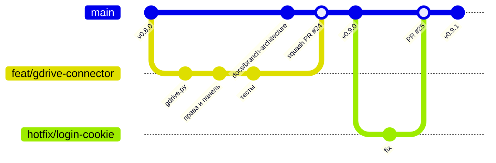

# Ветки, PR и выпуски

Схема работы репозитория Atom: как от `main` отходят ветки, как они возвращаются и как выпускается версия.
Правила — коротко в [CONTRIBUTING.md](../CONTRIBUTING.md); здесь — подробно и с примерами.

## Зачем так

Atom обновляется сам: `jarvis/updater.py` делает `git fetch` и `merge --ff-only` **из `main`** на VPS и на
домашнем сервере, а телефон забирает дашборд через GitHub Pages. Значит `main` — не «место, где мы
собираем работу», а **выпущенное состояние**: любой коммит в ней может уехать на живой сервер в течение
часа. Отсюда три следствия:

1. `main` всегда рабочая: тесты, запуск, обновление.
2. Всё новое приходит через PR, где это можно прочитать и проверить до вливания.
3. Ветки короткие: длинная ветка = большой дифф = дорогое ревью = риск, что `merge --ff-only` упадёт.

Второй ствол (`develop`, «integration», «release») проекту не нужен: релизов немного, а лишний ствол
пришлось бы синхронизировать с серверами, которые ходят только в `main`.

## Поток



Текстом то же самое:

```
main ──●──────────────●───────────────●───────────────●──→
        \            /                 \             /
         ●──●──●────●                   ●───────────●
      feat/drive (PR, squash)        hotfix/login (PR, squash)
        ↑ ветка удалена               ↑ ветка удалена
```

Порядок для любой задачи:

1. `git switch main && git pull --ff-only`
2. `git switch -c feat/короткое-имя`
3. коммиты (один — одна мысль)
4. `make check` — как в CI
5. `git push -u origin feat/короткое-имя`
6. PR в `main` по шаблону; черновик, если работа не закончена
7. ревью владельца, зелёный CI
8. **Squash and merge**, ветка удаляется
9. если это выпуск — тег `vX.Y.Z` на `main`

Пока ветка живёт, `main` уходит вперёд. Подтягивать её так:

```bash
git switch feat/короткое-имя
git merge main        # merge, не rebase: rebase в истории PR путает ревью и ломает чужие клоны
```

Конфликты решаются в ветке, а не в `main`.

## Выбор ветки

Первый вопрос — **что именно меняется**, а не «насколько это большое».

| Меняется | Ветка | Пример |
|---|---|---|
| Появилось то, чего не было: экран, коннектор, панель, интент, инструмент Claude | `feat/` | `feat/drive-connector`, `feat/meetings-week` |
| Сломанное поведение становится правильным | `fix/` | `fix/gaze-session-404` |
| Только тексты: README, docs/, CLAUDE.md, AGENTS.md, тексты интерфейса | `docs/` | `docs/branch-architecture` |
| Код переставлен, поведение прежнее | `refactor/` | `refactor/vault-atomic-write` |
| Только тесты, фикстуры, проверки | `test/` | `test/finance-edge-cases` |
| Зависимости, CI, Makefile, скрипты, `.env.example` | `chore/` | `chore/pin-aiohttp` |
| Стало быстрее или легче при том же поведении | `perf/` | `perf/notes-index` |
| Срочно, уже выпущено и мешает жить | `hotfix/` | `hotfix/login-cookie` |
| Гипотеза, может быть выброшена | `exp/` | `exp/globe-webgl` |

Сомнение «фича это или рефакторинг» решается просто: **если пользователь заметит разницу — `feat` или
`fix`**. Если нет — `refactor`.

Смешанные задачи делятся: сначала `refactor/` (поведение то же, тесты те же), потом `feat/` поверх.
Так ревью видит отдельно «переставили» и «добавили».

## Имя ветки

```
<тип>/<что-меняется>
```

- латиница, строчные, дефисы, цифры; до 40 символов;
- без имён людей, дат и слов `new`, `update`, `fix2`, `final`;
- `feat/gdrive-connector` — хорошо; `feat/AddNewGoogleDriveConnectorForOperators` — плохо.

Ветка отвечает на вопрос «что я увижу в диффе», поэтому имя — существительное с уточнением:
`fix/operator-notes-404`, `docs/branches`.

## Коммиты

Формат: `тип(область): смысл`. Типы те же, что у веток (`feat`, `fix`, `docs`, `refactor`, `test`,
`chore`, `perf`). Область — модуль или окно: `drive`, `web`, `operators`, `core`, `news`, `webapp`.

```
feat(drive): коннектор Google Drive и выдача доступа операторам

Владелец подключает Диск по refresh-токену, отмечает файлы в «Команде» — оператор видит
только отмеченное и без личности владельца: ни почты, ни владельцев файла, ни общего пути.
Копия в папку оператора — по кнопке «Сохранить к себе».
```

Правила:

- заголовок до 72 символов, без точки, в повелительном наклонении;
- тело объясняет **зачем**; «что» видно в диффе;
- ссылки на issue — в теле (`Закрывает #12`);
- один коммит — одно изменение; «попутно поправил опечатку» — отдельный коммит `docs:`.

## PR

Заголовок PR = заголовок будущего squash-коммита, поэтому он важнее заголовков внутри ветки.

Хорошее описание отвечает на три вопроса:

1. **Что** стало иначе для человека (не «добавил класс», а «оператор видит файлы Диска, которые ему
   открыли»).
2. **Зачем** — какая проблема, чьи слова, какое наблюдение.
3. **Как проверить** — шаги, которые ревьюер повторит за минуту.

Прикладывать:

- скриншот или видео для любого UI (телефон важнее десктопа: проект живёт на iPhone);
- для изменений формата заметок — фрагмент заметки до/после;
- для новых настроек — строку `.env.example`.

Черновик (`Draft PR`) уместен, если работа идёт больше дня: видно направление, можно рано поймать
«нам это не нужно».

## Ревью

Ревьюер смотрит по порядку:

1. **Решение.** Это вообще то, что просили? Нет ли более простого пути (у проекта уже есть модуль,
   который это умеет)?
2. **Границы.** Не сломано ли рядом: операторы, iPhone-режим, синхронизация хранилища, `--tunnel`.
3. **Тесты.** Есть ли тест на новое поведение и на новую ошибку.
4. **Секреты и данные.** Не уехали ли токены, `data/`, личные заметки в публичный репозиторий.
5. **Стиль.** Уже в конце: flake8 и `make check` ловят механику.

Замечания не про эту задачу — отдельным issue, не в PR.

## Вливание

- Только **squash**: один PR — один коммит в `main`. История читается как список изменений продукта.
- Заголовок squash-коммита = заголовок PR (GitHub подставляет его сам).
- После вливания ветка удаляется — и локально `git branch -d`, и на GitHub.
- Вливает владелец. Автор PR не вливает свой PR даже с зелёным CI.

## Выпуск и hotfix

- Версия — аннотированный тег на `main`: `git tag -a v0.9.0 -m "Версия 0.9.0" && git push origin v0.9.0`.
- Номер версии — смысл, а не дата: `0.9.0` — новая возможность, `0.9.1` — исправление.
- `hotfix/` отвечается от тега, если `main` уже ушла вперёд, но правка нужна выпущенной версии. После
  вливания в `main` — новый тег. Причина: серверы обновляются только из `main`, отдельной ветки
  «прод» у проекта нет.

## Защита main

Настройки репозитория (Settings → Branches → Add branch protection rule, шаблон `main`):

- [x] Require a pull request before merging (0 approvals — проект личный, но PR обязателен)
- [x] Require status checks to pass: `CI`
- [x] Require branches to be up to date before merging
- [x] Require linear history
- [x] Do not allow force pushes
- [x] Do not allow deletions

Те же правила действуют и без галочек — они в [CONTRIBUTING.md](../CONTRIBUTING.md); защита нужна, чтобы
их нельзя было обойти случайно.

## Частые вопросы

**Можно ли коммитить прямо в `main`, если правка в одну строку?**
Нет. Одна строка в `main` — это то, что через час может уехать на сервер без тестов и ревью.

**Ветка прожила неделю и разошлась с `main` — перебазировать?**
Нет, `git merge main` в ветку. Rebase переписывает коммиты, на которые уже смотрели в PR.

**Нужен ли CHANGELOG?**
Пока нет: историю PR читает владелец, а теги фиксируют выпуски. Появится внешний пользователь — заведём.

**Куда девать эксперимент, который не взлетел?**
`exp/`-ветку удалить, выводы — в issue или в `docs/`. Мёртвый код в `main` не храним.
